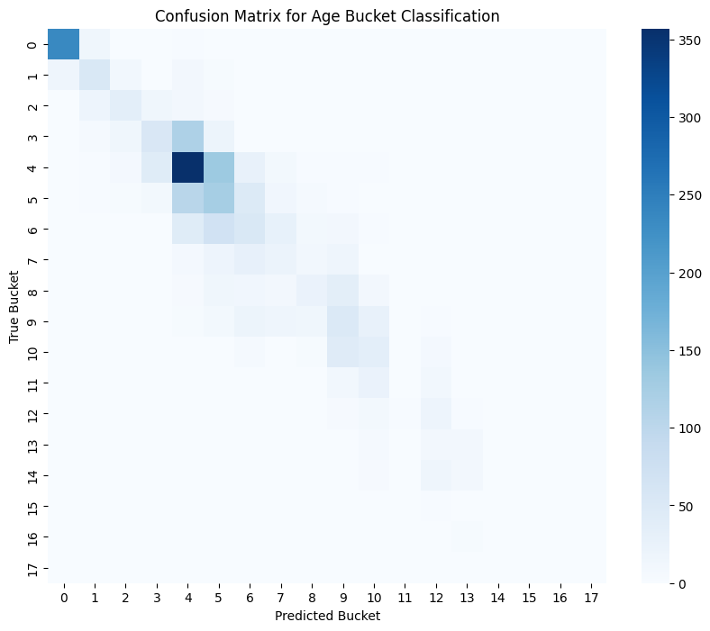
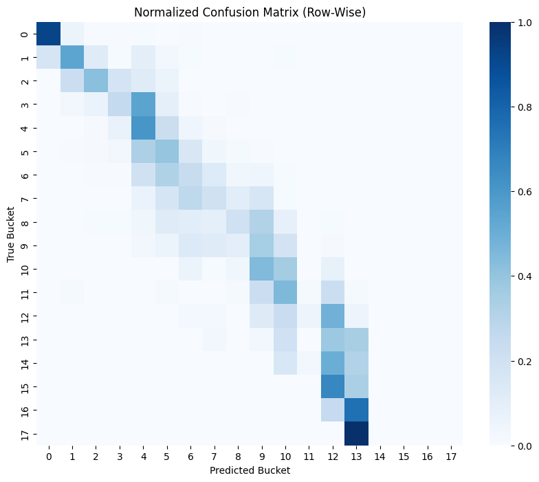

# Age-Bracket Estimation with Transfer Learning

Predict which **6-year age bracket** a person falls into from a single face photo. A
ResNet34 pretrained on ImageNet is fine-tuned on the [UTKFace](https://susanqq.github.io/UTKFace/)
dataset, with MediaPipe face detection and cropping in front of it. The intended use is a
cheap first-pass **age check** that can flag borderline cases for a human to review, not an
automated final decision.

Built by Raunak Batavia, Raj Bedara and Archie Tuscano. The full write-up is in
[`docs/Age_Verification_Using_Transfer_Learning.docx`](docs/Age_Verification_Using_Transfer_Learning.docx).

```
photo ──► MediaPipe face detect ──► crop (+25% margin) ──► 224x224, ImageNet norm ──► ResNet34 ──► age bracket (0-19)
```

## Approach

| Step | Detail |
| --- | --- |
| **Data** | UTKFace, about 24,000 face photos labelled with age (the age is the first field of each file name). Race and gender labels are ignored. |
| **Face cropping** | MediaPipe face detection, bounding box expanded by 25% on each side (the value the team found best after testing), clamped to the image, resized to 224x224. 24,109 images were processed. |
| **Why buckets** | Regressing the exact age (MAE) was too noisy for this dataset and model, so ages are binned into 6-year classes (`age // 6`, 20 classes) and trained with cross-entropy. |
| **Model** | ResNet34 (ImageNet weights) with a new head: `Linear(512,128) -> ReLU -> Dropout(0.3) -> Linear(128,20)`. ResNet18 was judged too light and ResNet50 too heavy for the available compute. |
| **Training** | Adam, lr 1e-5, batch 32, 5 epochs (in an earlier 10-epoch run the validation loss rose after epoch 4, i.e. overfitting). Split: 10% test, then 20% of the remainder for validation (72 / 18 / 10). |

## Results

On the held-out test split: **test accuracy 44.85%** (test loss 1.4912) across **20 age buckets**.
Uniform random guessing over 20 classes would score 5%.

| Epoch | Train loss | Validation loss |
| --- | --- | --- |
| 1 | 2.233 | 1.739 |
| 2 | 1.682 | 1.519 |
| 3 | 1.478 | 1.437 |
| 4 | 1.310 | **1.421** |
| 5 | 1.142 | 1.464 |

Per the report, most errors land in a neighbouring bracket, and the youngest brackets are the most
reliable (over 70-80% for many of them). Teenage and older brackets are the hardest.

| Confusion matrix | Row-normalised |
| --- | --- |
|  |  |

**Real-world check (from the report):** the team also ran the model on about 20 photos of group
members, family and friends. Most predictions were plausible; the outliers were photos with poor lighting or
glasses. The set is small, so treat this as a sanity check rather than a measurement.

## Getting started

```bash
git lfs install                      # once per machine: the weights are stored with Git LFS
git clone https://github.com/RaunakB7000/age-estimation-transfer-learning.git
cd age-estimation-transfer-learning
pip install -r requirements.txt
cd notebooks && jupyter notebook
```

The notebooks use relative paths and are meant to be run from `notebooks/`, in order:

1. **`01_data_preprocessing.ipynb`**: download UTKFace (the team used the
   [Kaggle copy](https://www.kaggle.com/datasets/jangedoo/utkface-new)) into `data/UTKFace/`, then
   run it to write cropped faces to `data/cropped/<age>/`.
2. **`02_training.ipynb`**: train, evaluate on the test split, and draw the confusion matrices.
   Saves weights to `models/Training_Data_Bucket_Save.pth`.
3. **`03_real_world_testing.ipynb`**: run the trained model on your own photos in
   `real_world_images/` and print each photo's predicted bracket.

**You can skip steps 1-2.** The trained weights (`models/Training_Data_Bucket_Save.pth`, 85 MB, Git LFS)
are included, so you only need notebook 3 plus a few photos of your own. A bracket `b` means ages
`6b` to `6b+5` (e.g. bucket 4 = 24-29).

`scripts/face_crop_demo.py <image>` shows the face-crop step on a single image.

## Notes and limitations

- **Accuracy is modest** (44.85%) and the dataset is small, low-resolution and noisy. Use it to flag
  cases for review, not to make decisions about people.
- **Bias is not evaluated.** Race and gender labels were dropped and no per-group analysis was done;
  UTKFace's age distribution is also uneven, which hurts the older brackets.
- **Notebook vs report:** the report describes two phases (a head-only run, then unfreezing
  `layer4` at lr 1e-5). `02_training.ipynb` holds the second run, and it never sets
  `requires_grad = False` on the earlier layers, so as written the *whole* network is fine-tuned. To
  match the report, freeze all parameters first and then re-enable `layer4` (the new head trains by default).
- **MediaPipe version:** the code uses the legacy `mp.solutions.face_detection` API, which newer MediaPipe
  releases removed, so `requirements.txt` pins `mediapipe==0.10.21`.
- Ideas from the report for future work: handling accessories such as glasses, a wider real-world test
  set, and age-aware generative models (e.g. Age-GAN).

## Repository layout

```
notebooks/    01 preprocessing, 02 training and evaluation, 03 real-world testing
models/       Training_Data_Bucket_Save.pth: trained ResNet34 weights (Git LFS)
scripts/      face_crop_demo.py: the crop step on one image
real_world_images/  put your own test photos here
docs/         project report (.docx) and result figures
data/         (not committed) UTKFace and the cropped dataset go here
```

## Credits

Dataset: UTKFace, Zhang, Song and Qi (CVPR 2017). Face detection: Google MediaPipe. Backbone: ResNet34
(He et al., 2016), ImageNet-pretrained weights from torchvision.
